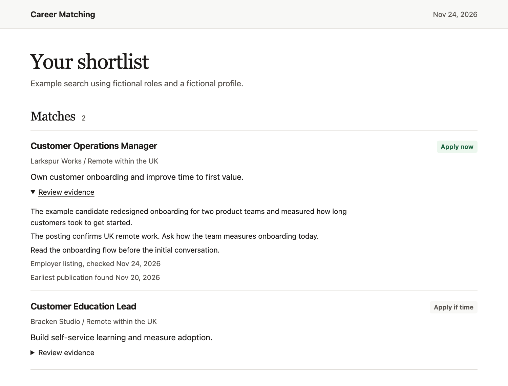
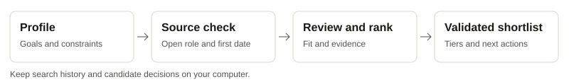

# Career Matching

Find open roles and see which ones fit your experience and the work you want. Career Matching checks employer listings, explains each recommendation and keeps your search history on your computer.

## Try an example

Install [Git](https://git-scm.com/downloads) and [Python 3.11 or later](https://www.python.org/downloads/). Then run:

```sh
git clone https://github.com/ryan-hennebry/career-matching.git
cd career-matching
python3 scripts/career_match.py demo
```

On Windows, use `py -3` in place of `python3`. The example uses fictional jobs and runs offline without an account. It shows why a recent listing is recommended and why a republished one is skipped. Run `python3 scripts/career_match.py preview` to open the result in your browser.



## Search for your own roles

Install and sign in to [Claude Code](https://code.claude.com/docs/en/quickstart) or [Codex CLI](https://learn.chatgpt.com/docs/codex/cli). From the repo, run `claude` or `codex` with its normal permissions and ask: **"Help me set up my search profile and find roles that fit it."**

The agent asks about your experience, interests and constraints. It reads the postings, checks the evidence and produces an **Apply now** and **Apply if time** shortlist. You can ask why a role moved, mark a role as submitted or request a brief for a role you choose.

The [usage guide](docs/usage.md) explains sources and setup. The [matching policy](references/matching-policy.md) explains how roles are assessed and ranked.

## How it works

<picture>
  <source media="(prefers-color-scheme: dark)" srcset="assets/how-it-works-dark.svg">
  
</picture>

The agent reviews the work and records what it found. Python checks and orders the records, including older posting dates across confirmed relists. Each run records which sources were checked and what remains unresolved. The [design notes](docs/design.md) explain the tradeoffs and tests.

The dashboard runs locally. Your AI client may process files or text you share with it. The project has no mail or application submission path.

[MIT license](LICENSE)
